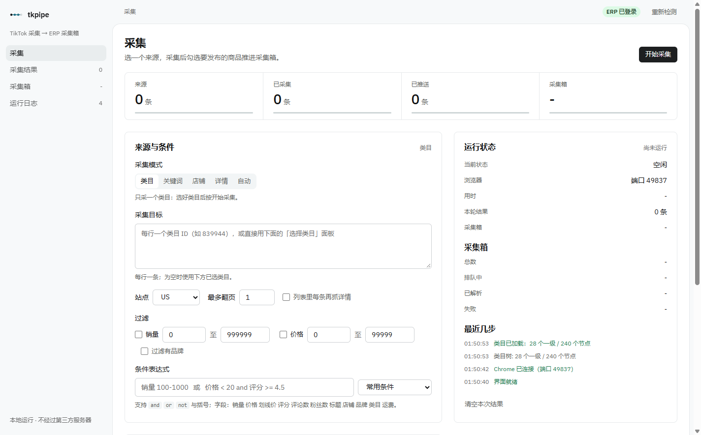
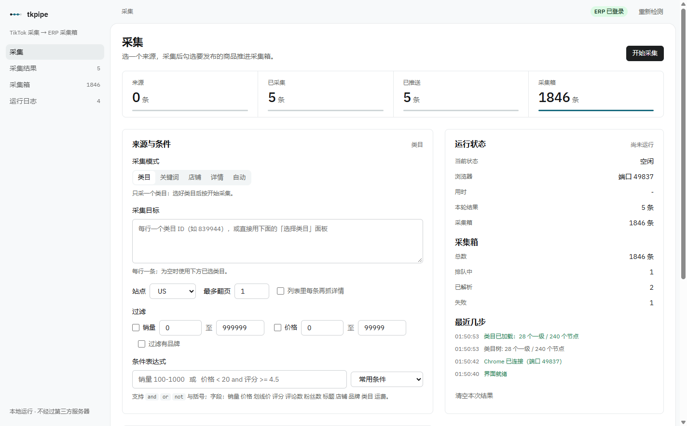
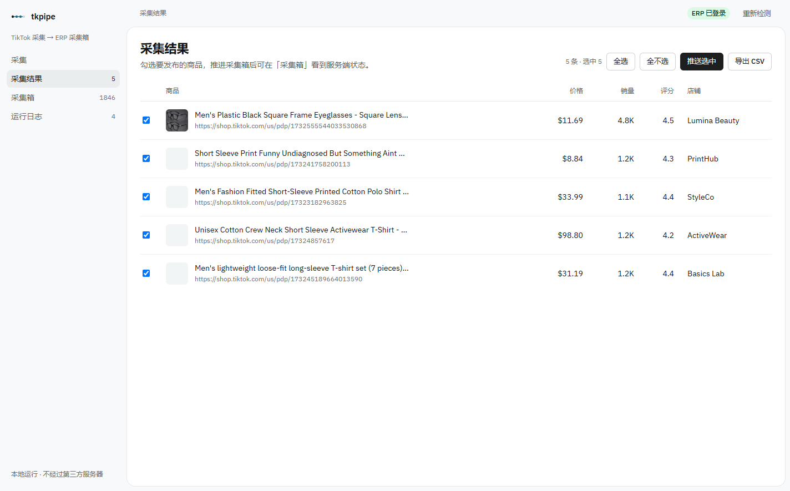
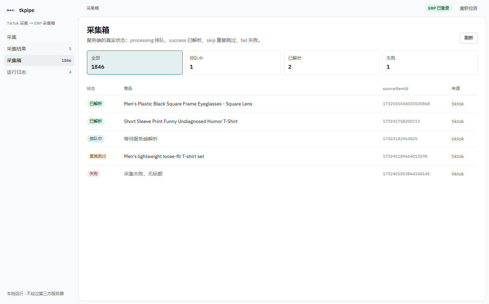

# tkpipe —— TikTok 采集 → 妙手 ERP 采集箱

一个**零依赖、可脚本化**的 TikTok Shop 商品采集 → 妙手 ERP 采集箱工具链：

- 从 `shop.tiktok.com` 采集商品（列表 / 详情 / 店铺 / 关键词 / 类目）
- 用条件表达式（`销量 100-1000`、`价格 < 20 and 评分 >= 4.5`）自由筛选
- 一键推送进妙手 ERP 采集箱（`push_collect_box`）
- 附带本地 Web UI 与命令行两种用法

不需要装浏览器扩展、不需要开 ERP 网页登录，只要有 cookie 就能跑。

> 本项目是个人学习/自用工具，使用前请阅读 [DISCLAIMER.md](./DISCLAIMER.md)。

---

## 设计取舍

常见的做法是「在商品页用 JS 点一个注入按钮，让扩展去提交」，但这条链路依赖 DOM：

```
商品页 → 点扩展注入的按钮 → 扩展后台发请求
```

按钮 class 一改、或浏览器升级禁用 `--load-extension`，链路就断。
本项目**不依赖任何页面按钮**，直接用浏览器里的登录态（cookie）调用同一套 HTTP 接口，
所以页面改版也不会影响提交。

---

## 快速开始

```bash
# 0. 准备 cookie（从已登录的 erp.91miaoshou.com 复制）
#    存成项目根目录的 cookies.json，扁平对象即可：
#    { "mserp_sst": "...", "accountId": "...", "autoLoginToken": "...", "tfstk": "..." }

# 1. 环境自检（不需要浏览器）
node src/cli.js doctor

# 2. 检查 ERP 登录态
node src/cli.js check

# 3. 采集列表 → 导出 CSV
node src/cli.js collect https://shop.tiktok.com/us --mode list --pages 1

# 4. 采集 + 直接推送进 ERP 采集箱
node src/cli.js push https://shop.tiktok.com/us --mode list --pages 2

# 5. 图形界面
node src/server.js          # → http://127.0.0.1:7788
```

### 图形界面

```bash
node src/server.js --port 7788
```

浏览器打开 <http://127.0.0.1:7788>，可以：检测 ERP 登录 → 填 URL 采集 → 勾选商品 → 一键推送 → 看采集箱真实状态。

---

## 命令行

| 命令 | 作用 |
| --- | --- |
| `check` | 检查 ERP 登录态与账号版本（纯 HTTP，不开浏览器） |
| `doctor` | 环境自检：Chrome 路径 / cookie / ERP 登录 |
| `login` | 打开浏览器手动登录 ERP，自动抓 cookie 存到 `cookies.json` |
| `collect <url...>` | 采集，导出 CSV |
| `keyword <词...>` | 关键词搜索采集 |
| `cats` | **列出类目树**（28 一级 + 240 节点，带 ID）；`--level 1` / `--search 词` / `--json` |
| `push <url...>` | 采集 + 推送进 ERP 采集箱 |
| `push --file out.json` | 用已有 JSON 推送 |

采集模式（`--mode`）与「美区截流采集软件」5 种采集类型一一对应：

| 场景 | tkpipe 命令 |
| --- | --- |
| ① 采集同行全店/爆品（店铺列表 + 商家信息） | `collect --mode shop <店铺URL>` |
| ② 关键词自动找同行/爆款 | `keyword <关键词>` 或 `collect --mode keyword` |
| ③ 同行/爆款详情（18 字段） | `collect --mode detail <详情URL>` |
| ④ 自动采集到妙手ERP | `push`（协议层直连，不点按钮） |
| ⑤ 类目采集（可自选单一类目） | `cats` 查类目 → `collect --mode category <类目ID>`；Web UI 有可展开的类目下拉页 |

### 类目采集（自选单一类目）

先查类目树：

```bash
node src/cli.js cats                    # 28 个一级 + 全部二级，带 ID
node src/cli.js cats --level 1          # 只看一级
node src/cli.js cats --search 女装       # 按名字搜
node src/cli.js cats --json             # 导出 categories-us.json
```

输出示例：

```
601450   Beauty & Personal Care
         └ 849032   Hand & Foot Care
         └ 849544   Eye & Ear Care
824328   Menswear & Underwear
         └ 839944   Men's Tops
         └ 840072   Men's Bottoms
```

再按类目 ID 采集（`--pages N` = 点几次「View more」，每批约 10 条）：

```bash
node src/cli.js collect --mode category 839944 --pages 5     # 约 50 条男装上衣
node src/cli.js collect --mode category 839944 --pages 5 --where "销量 100-1000 and 价格 < 30"
```

Web UI：模式选 `category` → 下方出现「选择类目」下拉页 → 点一级展开二级 → 选中后自动把类目 ID 填进 URL 框 → 点「开始采集」。顶部有搜索框可直接筛类目。

> 实测：类目 URL 里的 slug 可以随便写，只认末尾的数字 ID（`/c/x/839944` 与 `/c/men-s-tops/839944` 等价），所以只要拿到 ID 就够。

常用参数：

| 参数 | 说明 |
| --- | --- |
| `--cookie "a=b; c=d"` | 直接给 cookie 字符串 |
| `--cookie-file <path>` | 从 JSON 文件读（默认自动找 `./cookies.json`） |
| `--mode list\|detail\|auto\|shop\|keyword\|category` | 采集模式，默认 auto |
| `--site us` | 站点，关键词/类目模式用，默认 us |
| `--pages N` | 列表最多翻几页 / 类目页最多点几次「View more」 |
| `--with-detail` | 列表里每条再抓一次详情 |
| `--where "条件"` | **任意条件表达式**，见下节；可与下面几项叠加使用 |
| `--sales-min N` `--sales-max N` | 启用销量区间过滤（解析不出销量的会被跳过） |
| `--price-min N` `--price-max N` | 启用价格区间过滤 |
| `--brand-filter` | 过滤有品牌商品（仅详情模式生效） |
| `--slider manual\|auto` | 滑块模式，默认 manual（弹窗里手动拖） |
| `--chaojiying user:pass:softid` | 超级鹰账号，auto 模式用 |
| `--out <dir>` | 输出目录，默认 `./output` |
| `--json` | 额外导出 JSON |
| `--no-push` | 只采集不推送 |
| `--keep` | 结束后不关浏览器 |

### 条件表达式 `--where`

不想被固定的几个输入框限制时，直接写条件：

```bash
# 销量 100~1000
node src/cli.js keyword hoodie --where "销量 100-1000"

# 组合条件
node src/cli.js collect --mode shop https://shop.tiktok.com/us/store/lumina-beauty/7494582703660304372 \
  --where "销量 > 1000 and 价格 < 30 and 评分 >= 4.5"

# 排除法
node src/cli.js keyword "phone case" --where "not (品牌 = GAP) and 标题 !~ leather"
```

语法：

| 写法 | 含义 |
| --- | --- |
| `销量 100-1000` / `销量 100~1000` / `销量 100至1000` | 区间（闭区间） |
| `销量 between 100 and 1000` | 同上，显式写法 |
| `销量 >= 100` `价格 < 20` `评分 = 4.7` `评论数 != 0` | 比较 |
| `销量 100` | 裸数字按 `>=` 处理 |
| `标题 ~ hoodie` / `标题 !~ leather` | 包含 / 不包含（不区分大小写） |
| `品牌 = 无` | 无品牌商品（详情页 brand 为空或「无」） |
| `A and B` / `A or B` / `A 并且 B` / `A 或者 B` | 与 / 或 |
| `not (A)` / `!(A)` / `非 (A)` | 取反 |
| `(A or B) and C` | 括号分组 |

可用字段：`销量` `价格` `划线价` `评分` `评论数` `粉丝数` `已售出` `视频数` `标题` `店铺` `品牌` `链接` `类目` `运费` `关键词` `itemId` `站点` `描述`（也接受英文名 `sales` / `price` / `score` / `title` / `shop` / `brand` 等）。

数值支持 `1.2K` / `3M` / `1,234+` / `$27.00` / 千分位。

写错不会静默返回 0 条：CLI 直接报 `条件表达式有误: 未知字段「xxx」` 并 exit 2；HTTP 接口返回 400。

### 过滤语义

- **销量**：支持 `1.2K` / `3M` / `1,234+` / `576`；**解析不出销量的商品直接跳过**（宁可漏采，不要脏数据）
- **价格**：去掉 `$` 和逗号后转数字；价格为 `--` 或解析失败时**放行**（不因解析失败误杀）
- **品牌**：仅详情模式；`brand` 为空或 `"无"` 视为无品牌 → 保留，否则跳过

---

## 协议要点

这一节是实现时踩过的坑，改代码前先看。

### 1. ERP 的 `/api/open/**` 只吃 form-urlencoded，不吃 JSON

这套接口要求 `Content-Type: application/x-www-form-urlencoded`，提交体是 qs 序列化后的形式（`a=1&b[c]=2`）。
判断成功看响应里的 `result === "success"`。

用 JSON 提交会返回 `{"result":"fail","reason":"获取搬家数据为空，请检查来源是否合法!"}` —— 这个报错跟数据内容无关，纯粹是 Content-Type 不对。

### 2. `itemSimpleDetails` 必须是「以 itemId 为 key 的对象 map」，不是数组

这是最容易踩的坑。**两种格式都返回 `{"result":"success"}`，但结果完全不同**：

```js
// ❌ 数组：服务端拿不到 itemId
itemSimpleDetails = JSON.stringify([{ itemUrl, itemId, site, source, postFee }])
// → 采集箱里落成 sourceItemId="0"、title=null、status=processing 的空任务

// ✅ 对象 map：接口期望的格式
itemSimpleDetails = JSON.stringify({
  "1732569460347606004": { itemUrl, itemId, site, source, postFee }
})
// → 采集箱里落成真实 sourceItemId，服务端异步解析出 title，status 从 processing → success
```

实测：同一次运行里两种格式各推一条，采集箱里前者 `srcId=0 / title=null`，后者 `srcId=1732569460347606004 / title="Male Plastic Square Frame Eyeglasses..."`。

### 3. `sourceInfo` 的五字段契约

所有平台的采集模块都遵守同一个结构：

```js
{ itemUrl, itemId, site, source: 'tiktok', postFee: '' }
```

`site` 的推导顺序（`src/tiktok.js` 的 `getSourceInfoByItemUrl`）：

1. URL query 里的 `region=([A-Za-z]{2})`
2. host 里的 `shop-([a-z]{2})\.`
3. path 里的 `/shop/([a-z]{2})/pdp/`
4. path 里的 `/([a-z]{2})/pdp/`
5. host 是 `shop.tiktok.com` 时取 path 首段

最后过一遍 `SITE_MAP`（`uk→GB`, `sg→SG`, `us→US` ...）再大写。

### 4. TikTok 真实域名是 `shop.tiktok.com`，不是 `www.tiktok.com/shop`

`www.tiktok.com/shop` 会 302 到 `shop.tiktok.com/us`。详情页形态：

- `https://shop.tiktok.com/us/pdp/<slug>/<19位itemId>`
- `https://shop.tiktok.com/us/pdp/<19位itemId>`

### 5. 详情页字段的三个 DOM 陷阱

| 字段 | 陷阱 | 正确做法 |
| --- | --- | --- |
| 价格 | `span.Headline-Semibold` 左侧类目导航里有 5+ 个，会命中 "Beauty & Personal Care" | 找自身文本恰好是 `"$"` 的 span，取 `parentElement.textContent` |
| 划线价 | 变体名（如 "Maize Yellow"）也带 `line-through` | 必须用 `/^\$/` 过滤 |
| 店铺 Sold/Followers | 用 textContent 正则会拼成 "4.630.5K" | 找标签 span 后，在 `parentElement` 里成对取兄弟 span |
| 描述 | `innerText` 抓到的是左侧导航 | `div` 文本恰为 `Product description` 的 `nextElementSibling` |

### 6. 采集箱列表接口不在 `/api/open/` 下

```
POST https://erp.91miaoshou.com/api/move/common_collect_box/searchDetailList
form-urlencoded: pageNo=1&pageSize=20
→ { result:'success', detailList:[...], total:N }
```

`status` 取值：`processing`（排队）→ `success`（已解析）/ `skip`（重复跳过）/ `fail`。

### 7. Chrome 137+ 封禁了 `--load-extension`

如果要加载原扩展（本工具不需要），命令行参数已经失效，必须用 CDP：

```js
await cdp.send('Extensions.loadUnpacked', { path: '...\\erp-plugin' })
```

---

## 代码结构

```
tiktok-erp-pipeline/
├── src/
│   ├── cdp.js        Chrome DevTools Protocol 客户端（原生 WebSocket，零依赖）
│   ├── chrome.js     启动/发现 Chrome，读 DevToolsActivePort
│   ├── page.js       页面封装：evaluate / goto / click / screenshot / mouseDrag / watchNetwork
│   ├── slider.js     滑块验证：manual / auto(超级鹰) 两种模式
│   ├── tiktok.js     TikTok 采集器：列表、详情、店铺、关键词、类目、过滤、sourceInfo 推导
│   ├── erp.js        妙手 ERP 客户端：direct(cookie) / page 双模式
│   ├── pipeline.js   编排：采集 → 转 sourceInfo → 推送 → 导出
│   ├── cli.js        命令行
│   └── server.js     本地 Web UI（零依赖 http）
├── public/index.html 界面
├── test/smoke.js     离线冒烟测试（不联网、不开浏览器）
├── docs/screenshots/ 界面截图
├── cookies.json      本地凭据（已在 .gitignore，不要提交）
└── output/           导出的 CSV / JSON（已在 .gitignore）
```

### 自测

```bash
node test/smoke.js     # 49 项离线断言：sourceInfo / qs 编码 / payload / 销量价格解析 / 过滤语义 / 条件表达式 / 类目 URL
```

### 依赖

**没有第三方依赖。** 只用 Node 内置的 `http` / `fs` / `path` / 全局 `fetch` / 全局 `WebSocket`（Node 22+）。Chrome 用系统已装的。

---

## 功能总览

| 能力 | 用法 |
| --- | --- |
| 店铺全店采集（含商家信息） | `collect --mode shop <店铺URL>`（商品 + 粉丝数/已售出/视频数） |
| 关键词搜索采集 | `keyword <词>`（路由 `/us/s?q=`） |
| 商品详情（18 字段） | `collect --mode detail` / `--with-detail` |
| 类目采集 | `cats` + `collect --mode category <类目ID>`（`--pages N` = N 次 View more） |
| 推送 ERP 采集箱 | `push` |
| 销量区间过滤 | `--sales-min/--sales-max` |
| 价格区间过滤 | `--price-min/--price-max` |
| 品牌过滤 | `--brand-filter` |
| 任意条件筛选 | `--where "销量 100-1000"` / Web UI 条件框 |
| 超级鹰过滑块 | `--slider auto --chaojiying user:pass:softid` |

---

## 已知限制

1. **cookie 会过期**。`autoLoginToken` 是 JWT，过期后 `check` 会返回 `userNoLogin`，重新复制即可。也可以用 `node src/cli.js login` 走浏览器登录自动抓。
2. **免费账号有采集额度**。`getAccountVersionInfo` 返回 `isFreeAccount: true` 时受 `collectNumUnpaid` 限制。
3. **滑块验证是另一套页面**。首次访问 TikTok 的 `Security Check` 页面没有 captcha class，`slider.js` 的选择器抓不到它 —— 当前策略是等待/刷新，或手动拖。默认 `--slider manual`。
4. **服务端解析是异步的**。push 成功后采集箱条目先是 `processing`，几秒到几十秒后才变 `success` 并带上 title。这是正常的。
5. **只实现了 TikTok**。其它平台（temu / amazon / shopee / walmart ...）的 `sourceInfo` 契约一致（`{itemUrl,itemId,site,source,postFee}`），新增平台可参考 `src/tiktok.js` 顶部的模块注释。
6. **浏览器会被自动重建**。Chrome 崩溃或调试连接断开时，`ensureBrowser()` 会检测到并重启一个新的，无需手动重开服务。

---

## 界面

采集页：左边选来源与条件，右边是运行状态、采集箱计数与最近几步。顶部四个格子是这一轮的进度。



类目选择：28 个一级、240 个节点，可搜索、可展开，点一下就填进采集目标。



采集结果：价格 / 销量 / 评分 / 店铺一行看完，勾选后直接推送。



采集箱：服务端真实状态，排队中、已解析、重复跳过、失败分开显示。



---

## 许可

[MIT](./LICENSE)。使用前请阅读 [DISCLAIMER.md](./DISCLAIMER.md)。
